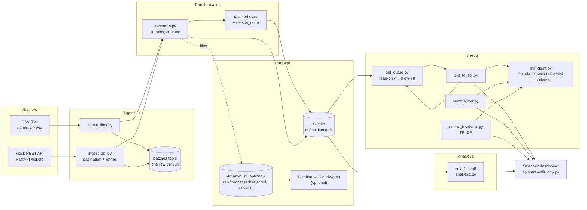

# Architecture

## Data flow in one sentence per stage

1. **Ingestion**: a CSV is read as text, or the API is paged through. Each run registers a new
   `batch_id` (`B-YYYYMMDD-NNN`) with source, size and `input_rows`. Raw files are never modified.
2. **Transformation**: `clean(df, batch_id)` standardises priority, category, status and dates,
   rejects bad rows with a reason, derives SLA fields and returns a report. raw = cleaned + rejected.
3. **Storage**: `load_batch()` upserts teams, agents and categories, upserts tickets (latest extract
   wins), and inserts resolutions and rejected records in **one transaction**. On error it rolls back
   and marks the batch `failed`. Output files can be copied to S3.
4. **Analytics**: eight SQL files share the same filter block (date range, team, priority,
   category). They run on a read-only connection and are tested against hand-calculated results.
5. **GenAI**: the LLM only *writes* SQL text and *explains* returned rows. The SQL guard decides
   what runs. Every question is logged in `ai_query_log`.

## Safety layers for AI-generated SQL

| Layer | What it stops |
|---|---|
| Write-intent check on the question ("delete …", "drop …") | obvious write requests, before any LLM call |
| Static validation (`validate_sql`) | anything but one `SELECT`/`WITH`; write keywords; `;` stacking; comments; non-approved tables (`ai_query_log`, `rejected_records`, `sqlite_*`, views, `pragma_*`); `load_extension` |
| `LIMIT 200` added or capped | huge result sets |
| Read-only connection (`mode=ro`, `PRAGMA query_only`) | any write, even if a check were bypassed |
| SQLite authorizer | reading any table outside the allow-list, at engine level |
| 5-second progress-handler timeout | runaway joins |
| Grounding check on the explanation | flags numbers that are not in the result rows |

## Tables

`batches`, `teams`, `agents`, `categories`, `tickets`, `resolutions`, `rejected_records`,
`ai_query_log` (schema in `db/schema.sql`). One addition to the brief: `batches.file_size`.
The view `v_tickets` joins tickets to their dimensions for the analytics queries; the AI cannot use it.
